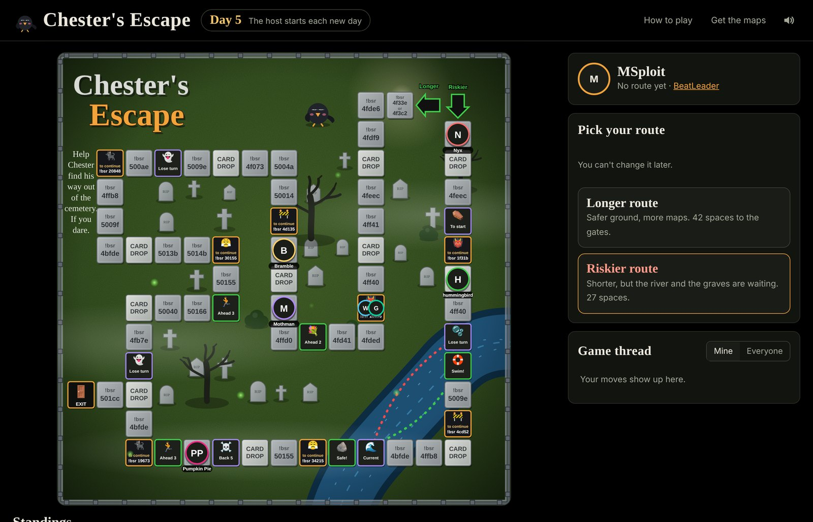

# Chester's Escape

A Beat Saber board game. Roll a d4 once a day, move your token, and play the map on the space you land on. BeatLeader confirms the clear, so there are no replays to post and nobody moves tokens by hand.

**Play it here: [spanky3651.github.io/Chesters-Escape](https://spanky3651.github.io/Chesters-Escape/?utm_source=github&utm_campaign=readme)**

## How to play

- Pick the **longer route** (more spaces, safer) or the **riskier route** (fewer spaces, more ways to get sent back). You can't switch later.
- A new game can open for sign-ups early. Join and pick your route, and the page counts down to the first roll.
- Roll once a day. The day turns over at 12:59 AM Eastern.
- **Map spaces:** play that map. Any difficulty, any modifiers. The game finds your score on BeatLeader and unlocks your next roll.
- **Blocker spaces:** you stop until you play their map.
- **Card drops:** draw a card. Some help, some hurt, some add a bonus map.
- **Event spaces** can push you ahead, send you back or cost you a turn.
- If a card or event moves you onto a map, play it. It never chains into another card or event.
- First one to the finish wins. Everyone else keeps playing for their place.

If you played a map and it doesn't show up (for example a replay that wasn't a new personal best), tap **I played it** and the host can approve it.

## Board designer

`designer.html` lays out a board on top of your own art: upload the image, click each square in order, and set what it does (map, blocker, card drop, move, lose a turn, back to start, or a current that carries you elsewhere). Themes swap the art, event names and card text, so the same board can run as a Halloween or a Christmas game.

## Built with

Map info from [BeatSaver](https://beatsaver.com). Scores from [BeatLeader](https://beatleader.com).
