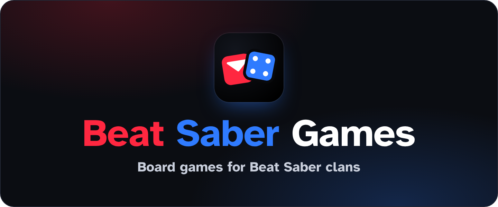
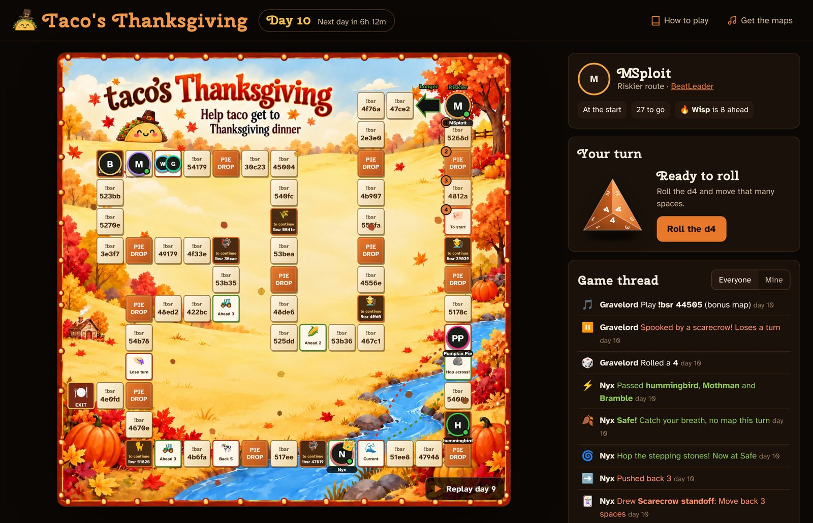
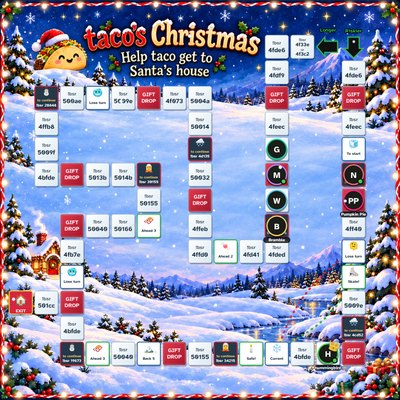
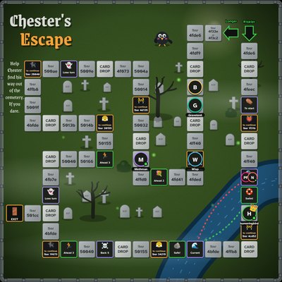
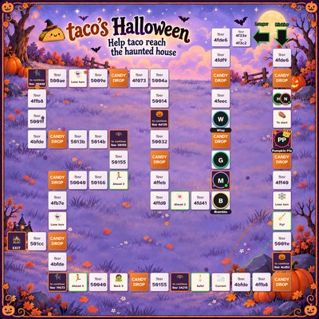
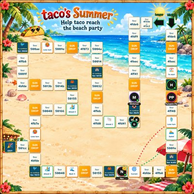

  

<b><a href="https://beatsabergames.com/?utm_source=github&amp;utm_campaign=readme">Play at beatsabergames.com</a></b>

Board games for Beat Saber clans. Roll a d4 once a day, move your token, and play the map on the space you land on. BeatLeader confirms the clear, so there are no replays to post and nobody moves tokens by hand.

## How to play

- Pick the **longer route** (more spaces, safer) or the **riskier route** (fewer spaces, more ways to get sent back). You can't switch later.
- Between games the board stays hidden. The next theme, board and maps are revealed when sign-ups open.
- Join and pick your route while sign-ups are open, and the page counts down to the first roll.
- Roll once a day. The day turns over at 12:59 AM Eastern.
- **Map spaces:** play that map. Any difficulty, any modifiers. The game finds your score on BeatLeader and unlocks your next roll.
- **Blocker spaces:** you stop until you play their map.
- **Card drops:** draw a card. Some help, some hurt, some add a bonus map.
- **Event spaces** can push you ahead, send you back or cost you a turn.
- If a card or event moves you onto a map, play it. It never chains into another card or event.
- Every roll ends with a map. If your turn stops on a space without one, you get a bonus map. A Safe space is the only break.
- First one to the finish wins. Everyone else keeps playing for their place.
- Only one player can escape per day. If someone already got out today, you wait at the gate and walk out on your next roll.
- A game can have an end date. When it hits, the standings freeze: escaped players by place, then everyone else by how close they got.

Turn on roll reminders on your phone and the game nudges you in the evening if your roll or map is still waiting. Missed a day? Hit **Replay** on the board to watch everyone's moves from the last day, and the page tells you what happened while you were away.

If you played a map and it doesn't show up (for example a replay that wasn't a new personal best), tap **I played it** and the host can approve it.

## A new theme every game

|  |  |  |  |
| :---: | :---: | :---: | :---: |
| Taco's Christmas | Chester's Escape | Taco's Halloween | Taco's Summer |

Themes swap the board art, event names and card text, so the same game can run as a Halloween, Thanksgiving, Christmas or summer game.

## One game per clan

Each clan Discord server gets its own game, with its own board, players and theme. Sign in with Discord and you land in your clan's game. If you're in more than one of the clan servers, you pick a game the first time and can switch any time with the server icons at the top of the page. A clan can also bring its own songs: the Beaters board plays hummingbird's 50 picks, spread so both routes get the same average song length and density.

A game can also run in AccSaber mode, where finishing an AccSaber daily mission unlocks your roll instead of a map.

**Running a Beat Saber clan?** [Message MSploit on Discord](https://discord.com/users/909550896571113492) about setting up a game for your server.

## Board designer

`designer.html` lays out a board on top of your own art: upload the image, click each square in order, and set what it does (map, blocker, card drop, move, lose a turn, back to start, or a current that carries you elsewhere). A theme can bring its own board art, like the taco boards for Halloween, Thanksgiving, Christmas, New Year, Valentine's Day, Easter and summer.

## Card editor

The designer's **Cards** tab lets anyone rewrite a theme's 20 cards and its event space names and add their own card pictures, with a live preview of each card. What a card does stays locked. Download the card pack and send the file to the host. The designer follows the clan game you're signed in to, so its themes and saved boards are for that game only.

## Built with

Map info from [BeatSaver](https://beatsaver.com). Scores from [BeatLeader](https://beatleader.com).
